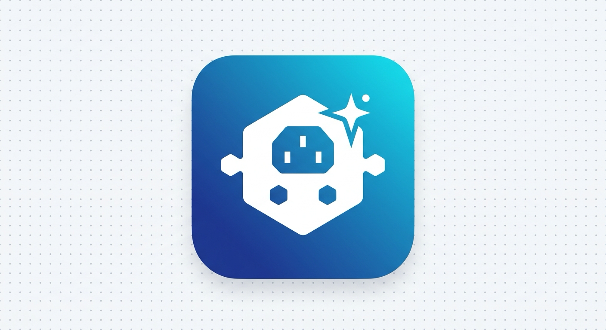

<p align="center">
  
</p>

<h1 align="center">Awesome DSH Plugins</h1>

<p align="center">
  面向 <a href="https://github.com/deepseek-ai/deepseek-harness">DeepSeek Harness</a> / DSH 的社区插件目录。
</p>

<p align="center">
  <a href="README.md">English</a>
</p>

本目录列出每个公开插件的用途、准确的公开安装来源、前置条件，以及特殊交付例外。
稳定条目使用固定的 registry 版本、Git release/tag、精确 commit 或 release tarball。

本目录**刻意不记录任何机器状态**。具体已装版本、本机路径和 profile 布局属于运行 DSH 的人，
不属于这份目录——这类内容每次安装都会过期。要看某台机器实际装了什么，去查那台机器：

```bash
dsh --profile <profile> --dump-config
```

私有仓库和机器本地集成不会列入这份公开目录，因为它们无法成为对所有 DSH 用户都可移植的安装物料。

## 目录条目规范

公开条目必须回答五个问题：

1. **它做什么？** 用一句话说明能力，并链接到权威仓库。
2. **它从哪里来？** 给出精确 registry 版本、Git release/tag、commit 或 release asset；
   如果安装器存在例外，必须明确写出。
3. **它需要什么？** 列出会影响安装或运行的 Host、运行时、provider、凭据、权限和 native service 前置条件。
4. **谁依赖它？** 说明 provider 先于消费者的顺序，并把可选集成和必需依赖区分开。
5. **如何验收？** 给出可复现的检查，并披露本地路径、信任边界、远程暴露和其他安全敏感副作用。

目录中不得出现某台机器的绝对路径、复制来的 profile 状态、私有凭据，或“当前已安装某版本”的表述。

## 目录

- [目录条目规范](#目录条目规范)
- [安装前须知](#安装前须知)
- [同名冲突：按来源安装，不要按包名安装](#同名冲突按来源安装不要按包名安装)
- [从 Git 主机安装](#从-git-主机安装)
- [插件目录](#插件目录)
- [固定安装示例](#固定安装示例)
- [依赖关系](#依赖关系)
- [Desktop 部署](#desktop-部署)
- [候选依赖 overrides](#候选依赖-overrides)
- [发布与上游检查](#发布与上游检查)
- [与上游的关系](#与上游的关系)
- [特殊产品](#特殊产品)
- [适配插件源码构建](#适配插件源码构建)
- [插件目录之外的 macOS 服务](#插件目录之外的-macos-服务)
- [验证清单](#验证清单)
- [许可证](#许可证)

## 安装前须知

1. **固定每一个可移植来源。** 只能用 registry 精确版本、受保护的 Git release/tag、
   精确 commit，或带 checksum 的 release tarball。禁止 `latest`、`main`、未固定分支，
   以及其他机器的 `link:`。Browser 安装器有明确记录的远程 bootstrap 例外；可复现路径是
   精确 tag 的本地 checkout，远程 fallback 只适合作为便利安装，不能视为固定来源。
2. **先在 candidate profile 验证。** 把插件加到一次性 profile 里，确认 DSH 能加载，
   再去动你真正在用的 profile。
3. **provider 先于消费者安装。** 提供模型或运行时服务的插件，必须先于依赖它的插件存在。
4. **不要手工维护 `dsh.profile.bundles`。** 每次 `dsh plugin add` 成功后让 DSH 自动 reconcile。
5. **不要手工修改 profile `node_modules` 里的文件。** 这种改动没有版本控制来源，
   `package.json` 也不再描述它，其他机器无法复现，下一次重装会静默还原。
   如果某个修复值得保留，它属于插件仓库——提交、打 tag、发布，然后安装那个已发布的 tag。
6. **不要在不同机器之间复制 `package.json`、lockfile 或 `node_modules`。**
   改为从固定的来源重新安装。
7. **迁移到正式 profile 后重启。** candidate 已通过不代表正在运行的正式 DSH 进程已经加载新物料，
   必须重启正式 profile。
8. **使用适合目标 profile 的包管理器。** Desktop 自带 CLI 使用内置 pnpm；普通 CLI 调用 `PATH` 上的 `pnpm`，
   而 profile 的 `node_modules` 记录了创建它的 store。不同大版本的 pnpm 会拒绝操作：

   ```text
   ERR_PNPM_UNEXPECTED_STORE
   ```

   遇到该错误时，应把构建该 profile 的 pnpm 版本放到 `PATH` 最前面，而不是重装整个 profile。
   另外，在 pnpm ≥ 11 下构建脚本授权位于 `pnpm-workspace.yaml`（`allowBuilds`），
   而 profile `package.json` 的 `pnpm` 字段已被忽略。

### `link:` 仅用于本机开发

只有在机器本地的开发 profile 中，且源码 checkout 已构建、运行时入口已确认之后，
才可以使用 `link:` 依赖。`link:` 不会执行目标包的 build，也不是可移植的安装格式。

## 同名冲突：按来源安装，不要按包名安装

本目录中有若干插件与公共 npm registry 上的**无关项目重名**。按裸包名安装会静默装错项目——
名字相同，代码不同：

| 裸包名 | 实际会装到 | 权威来源 |
| --- | --- | --- |
| `dsh-taskboard` | `cloader/dsh-taskboard` | `LiuRJ99/dsh-taskboard-cloader` |
| `dsh-spend` | `nonewind/dsh-spend` | `LiuRJ99/dsh-spend` |
| `dsh-image-gen` | `shanliuling/dsh-image-gen` | `LiuRJ99/dsh-image-gen` |
| `dsh-github-mcp` | `ZIye1208/dsh-github-mcp` | `GitRuozhi/dsh-github-mcp` |

这四个绝不能按裸包名安装。执行任何 `dsh plugin add` 之前，先看下方目录表中的固定来源：
Git 交付条目使用 tag/commit，ImageGen 使用经过校验的 release tarball。

## 从 Git 主机安装

`github:` 安装是否可行取决于仓库布局，因为 pnpm 不会执行 git 托管依赖的构建脚本，
除非消费者显式允许：

- **把构建产物 `lib/` 提交进仓库**的项目，可直接用
  `github:<owner>/<repo>#<tag>` 安装；
- **把构建产物写进 `.gitignore`** 的项目则不行：包会带着指向快照中不存在文件的 `main` 到达。
  这类项目只能走 release tarball 或仓库自带的安装器。

如果某个插件从 Git 主机安装后报入口文件缺失，先检查它的 `lib/`（或对应的 `main` 目标）
是否被 gitignore 了。

## 插件目录

| 插件 | 能力 | 安装来源 | 前置条件 |
| --- | --- | --- | --- |
| [`@LiuRJ99/dsh-cpa-plugin`](https://github.com/LiuRJ99/dsh-cpa-plugin) | CLIProxyAPI 模型供应商、GPT/Codex Responses 路由、账号/配额界面（含 Kimi Code）、速度模式、图片生成服务 | GitHub Release `v0.4.10` | DSH peer 服务；用户自行配置 CPA 地址和凭据 |
| [`@yuxianglin/dsh-bridge-browser`](https://github.com/LiuRJ99/dsh-browser) | 浏览器 bridge 工具与 Chrome/Firefox 扩展集成 | GitHub Release `v0.1.15-dev.1` bridge tarball + Chrome extension zip；bridge `0.0.15-dev.1` | 匹配的 bridge 与 Chrome 扩展物料；仅源码安装时需要同时构建；Firefox 需要单独构建与 token 配置 |
| [`@zibokapi/dsh-codex-computer-use`](https://github.com/LiuRJ99/dsh-computer-use) | macOS 应用状态、Accessibility Tree、截图、鼠标键盘输入、MCP 服务 | GitHub Release `v0.1.6-dev.3` | macOS、Xcode Command Line Tools、重建 native daemon、Accessibility 与 Screen Recording 授权 |
| [`dsh-better-sidebar`](https://github.com/omdsh-dev/DSH-better-sidebar) | Web 侧栏、资源管理器、编辑器、终端、Git、浏览器界面；`ctx.betterSidebar` 服务 | registry 精确版本 `0.28.0` | Taskboard 和 ImageGen 的可选 UI 服务；`0.28.0` 声明 DSH `^0.2.1-rc.1` peer；消费者的可选 peer 已覆盖该版本，见兼容性说明 |
| [`dsh-decision-engine`](https://github.com/LiuRJ99/dsh-decision-engine) | 面向 DSH 的模型中立低延迟决策层：提供可插拔决策引擎与 Provider、有限候选集决策协议，以及 Browser / Computer / Custom 环境适配器 | GitHub Release `v0.4.20` | DSH peer 服务；可选固定 SDK `@receptron/laya@0.1.1` 提供本地推理；若启用 browser/computer 适配器需相应宿主工具/插件支持 |
| [`dsh-github-mcp`](https://github.com/GitRuozhi/dsh-github-mcp) | GitHub 官方 MCP server 桥接（`mcp__github__*`）与 REST 文件读取 | 精确 Git commit `5be9077d46bfed66b76843bbcc7bdc459990b3af`（上游未发布 tag） | DSH 进程环境中的 `GITHUB_TOKEN`；DSH 通常从 `$DSH_HOME/.env` 加载 |
| [`dsh-image-gen`](https://github.com/LiuRJ99/dsh-image-gen) | CPA 图片生成、图片模型目录、图片编辑、Gallery 和工作区保存 | GitHub Release `v0.5.12` tarball asset；SHA-256 `5be2dd058ace13c976545482aafa5e233582bdd777d26a4c8a7fdbfcb872b05e` | 先安装 CPA；ImageGen 构建时使用 CPA `v0.4.9`，其 `>=0.4.0 <0.5.0` peer 范围覆盖本目录目标 `v0.4.10`。该仓库 `.gitignore` 了 `lib/`，从 Git 安装会没有入口 |
| [`dsh-mobile`](https://github.com/saya-ch/dsh-mobile) | 从移动设备访问 DSH 会话 | registry 精确版本 `0.6.1` | 局域网与可选远程访问分别控制；远程默认关闭，已配对设备完全受信，局域网使用固定本地 CA，远程使用 provider 的 HTTPS 端点。`0.6.1` 要求 Node `^22.19 || >=24`；配套移动客户端及配对流程需本地验证 |
| [`dsh-record-replay`](https://github.com/LiuRJ99/dsh-record-replay) | `orr_*` 工具与 `open-record-replay` skill，用于录制并回放桌面操作 | GitHub Release `v0.3.3-dev.2` | macOS 与 Xcode Command Line Tools；使用精确的 fork 版 [`open-record-replay`](https://github.com/LiuRJ99/open-record-replay) tag `v0.1.1`，通过 profile patch 指定 |
| [`dsh-sandbox-schema-shim`](https://github.com/xiaohj233/dsh-compat-shims) | 清理模型侧工具 schema 中多余的沙箱字段 | Git tag `sandbox-schema-shim-v0.1.1`，package path `/packages/sandbox-schema-shim` | DSH base profile |
| [`dsh-spend`](https://github.com/LiuRJ99/dsh-spend) | Token 用量、统计、计费计划识别和费用视图 | GitHub Release `v0.6.7-dev.3` | DSH session、credentials 和 Web UI peer 服务 |
| [`dsh-taskboard`](https://github.com/LiuRJ99/dsh-taskboard-cloader) | Host 权威任务、任务工具、工作区认领、调度和看板 UI | GitHub Release `v0.7.10` | Better Sidebar 为可选集成；向 Lazy Gate 发布能力元数据 |
| [`dsh-tool-lazy-gate`](https://github.com/LiuRJ99/dsh-tool-lazy-gate) | 默认门控 browser 与 computer-use，并可按配置门控 Taskboard/录制器工具族 | GitHub Release `v0.1.9` | browser/computer 是内置默认；Taskboard 与 Record/Replay 需要 capability 配置和 adapted skill 元数据；包含 Web connection workaround |

### 兼容性说明

目录目标 Host 为官方 DSH 0.2.1-rc.1。本轮维护的公开 fork 明确声明 0.2.0-rc.2 || 0.2.1-rc.1；Sidebar 0.28.0 声明 ^0.2.1-rc.1。其他 Host 不在本轮验证范围。逐包检查时包含 prerelease，只把 @deepseek-ai/dsh-* 放在 Host 版本线上比较。

CPA 0.4.10 使用 Host 提供的 peer 服务，避免安装另一份 settings/config-editor。CPA 与 Lazy Gate 0.1.9 的连接补丁保留 webStartup 和 webServer，不再要求已移除的 webRuntime。Browser 将 Host 提供的 Peer 传给 Gateway 调用、流与事件回传；身份不取自扩展 payload。Computer Use 不再强依赖已移除的 invariants 服务。

Taskboard 0.7.10 与 ImageGen 0.5.12 针对发布的 Sidebar 0.28.0 类型检查通过，可选 peer 为 ^0.21.1 || 0.24.1 || 0.26.0 || 0.28.0。Sidebar 的语言包 peer 是可选项。ImageGen 发布物使用 CPA 0.4.9 构建，其 >=0.4.0 <0.5.0 peer 覆盖目标 CPA 0.4.10；Git 不携带 lib，仍须安装校验后的 release tarball。

本轮保留 CPA-only 生图、Gallery 事务与工作区元数据、Taskboard 持久化 FIFO 和明确的会话归属、Browser 会话绑定与审批、Lazy Gate 的用户显式解锁。下方历史 Desktop、模型和原生权限实测只适用于注明的版本。

### 候选依赖 overrides

新建独立候选 profile，保留已有构建授权和不相关 overrides。本轮不再需要旧 CPA 的 @deepseek-ai/dsh-* overrides；移除旧 Host 的这些 pin，让官方 Host 提供服务。

```yaml
nodeLinker: hoisted
autoInstallPeers: false
```

pnpm 11 构建授权在 pnpm-workspace.yaml 的 allowBuilds，逐包审查后授权，不使用全局允许或版本豁免。Desktop 的安装命令使用自带包管理器；普通 CLI 使用与 profile store 一致的大版本。

## 固定安装示例

第一轮请使用新建的 `<candidate-profile>`。目标 profile 必须已经提供 DSH 官方 Web Host bundle；
它不是本目录中的社区插件。使用上文候选依赖配置。Computer Use 仅在 macOS 原生服务准备好后启用；其他平台跳过该行。下面只使用公开且精确的来源：

```bash
# 先安装 provider（受保护 release tag）。
dsh plugin --profile <candidate-profile> add \
  "github:LiuRJ99/dsh-cpa-plugin#v0.4.10"
# 精确 registry 版本。
dsh plugin --profile <candidate-profile> add dsh-better-sidebar@0.28.0
# 可选：只有需要移动访问时安装；Desktop-only 部署跳过。
dsh plugin --profile <candidate-profile> add dsh-mobile@0.6.1

# 固定来源；已发布 fork 使用精确 release tag。
dsh plugin --profile <candidate-profile> add \
  "github:LiuRJ99/dsh-decision-engine#v0.4.20"
dsh plugin --profile <candidate-profile> add \
  "github:LiuRJ99/dsh-computer-use#v0.1.6-dev.3"
dsh plugin --profile <candidate-profile> add \
  "github:GitRuozhi/dsh-github-mcp#5be9077d46bfed66b76843bbcc7bdc459990b3af"
dsh plugin --profile <candidate-profile> add \
  "github:LiuRJ99/dsh-record-replay#v0.3.3-dev.2"
dsh plugin --profile <candidate-profile> add \
  "github:xiaohj233/dsh-compat-shims#ba4088c1a7b77b1c73fd5d5438f46800720d6bcd&path:/packages/sandbox-schema-shim"
dsh plugin --profile <candidate-profile> add \
  "github:LiuRJ99/dsh-spend#v0.6.7-dev.3"
dsh plugin --profile <candidate-profile> add \
  "github:LiuRJ99/dsh-taskboard-cloader#v0.7.10"
dsh plugin --profile <candidate-profile> add \
  "github:LiuRJ99/dsh-tool-lazy-gate#v0.1.9"

# 迁移前检查组合后的 candidate。
dsh --profile <candidate-profile> --dump-config
```

candidate 通过后，用相同的精确来源重复安装到正式 profile，并重启 DSH。
不要把 candidate 的 `package.json`、lockfile 或 `node_modules` 复制到另一台机器。

## 依赖关系

```text
DSH base + DSH Web Host
├─ Better Sidebar ── 可选 UI 服务 ──┬─ Taskboard
│                                  └─ ImageGen
├─ CPA Provider ── 必需运行时服务 ── ImageGen
├─ Taskboard ── 能力元数据契约 ── Lazy Gate
├─ Record/Replay ── 能力元数据契约 ── Lazy Gate
├─ Record/Replay ── 调用 bin/orr.js ── fork 版 open-record-replay checkout
├─ GitHub MCP ── 读取 GITHUB_TOKEN ── DSH 进程环境（通常为 $DSH_HOME/.env）
├─ Browser bridge ↔ Chrome/Firefox 扩展
└─ Computer Use JS bundle ↔ macOS native daemon + TCC 权限
```

Lazy Gate 默认启用 `browser` 和 `computer` 两个族。启用对应 capability，且适配插件发布了
skill 元数据后，也可以门控 `taskboard` 和 `recorder`。每个门控族都只能由用户手输的 skill 调用解锁。
其中 `recorder` 门控 `orr_*`——它会原样捕获键入文本，**绝不能由模型自行触达**。

相互独立的插件（除宿主外不出现在上图）：

- Decision Engine
- Spend
- Mobile
- Sandbox schema shim

## Desktop 部署

官方 Desktop 使用自身 Host 和 Plugin Manager，CLI/Web profile 的安装结果不会自动出现在 Desktop。
安装前核对 Desktop 的实际 Host、Home 与 profile。在独立 candidate Home 中验证，保留已有配置和数据，
通过后再部署并重启正式 Desktop。从 Finder 启动时，使用该版本支持的 Home 配置方式，不假定继承终端的环境变量。
使用 Desktop 自身 Plugin Manager 和目录固定来源，provider 先于消费者安装，并移除旧 Host overrides。
仅保留官方桌面入口即可；Browser 不需要额外启动器，Computer Use 的原生 helper 仍按实际 provider 保留。

Browser 由 Desktop bridge 和独立加载的 Chrome 扩展组成。在 `chrome://extensions` 核对两个版本，
更新后重载，扩展与 bridge 使用同一固定 Release。桥地址留空时自动探测 `3080 / 3081 / 3090 / 14389 / 43189`；
实际 Host 使用其他端口时，在扩展内配置：

```text
ws://127.0.0.1:<实际 Desktop Host 端口>/ext/bridge
```

Chrome 本机 loopback 无需手动填写 token；Firefox 与远程部署仍按文档认证。
连接成功不等于获得控制授权：会话 `/browser` 门禁和扩展审批仍需遵守。
保留 Computer Use 的 native helper 与 TCC 权限；同一个 helper 同时出现在“辅助功能”和“录屏与系统录音”中，
并非两个客户端。Desktop 自身权限不能替代 helper 权限；原生 preflight 必须在实际 Host 内验证。

迁移前备份会话、附件、Taskboard、Gallery 与配置，迁移后核对标题、历史日志解析、任务工作区归属和图片资源。
不要复制 `node_modules`、改签官方应用或修改应用内 Host。独立 Web 与 Desktop Home 不会自动同步数据。
重启 Host 可能结束 Sidebar 终端。卸载独立 Web 时，仍须保留 Desktop 内部 HTTP / Browser bridge。
Mobile 为可选客户端，Desktop-only 部署跳过。

### Desktop 验收

下表保留早期组合的历史验证证据，不代表新目录目标或本机实时安装状态，也不保证其他凭据、平台或模型输入同样通过。
分类只针对表内明确验证的范围。

| 分类 | 功能 / 目标 | 证据与限制 |
| --- | --- | --- |
| 完全可用 | CPA `0.4.8`、WorkBuddy `0.2.7` | 真实文本模型回复；生图/编辑复测成功，但某次 provider 编辑返回只有文字 |
| 完全可用 | Browser `v0.1.13-dev.1` | 540 源码测试；用户重载并批准后，后台开页保留前台，后续输入与点击准确作用于新后台页；Firefox 未测 |
| 完全可用 | Taskboard `0.7.7` | 439 测试通过，2 项可选 Git 测试跳过；两个定时任务获真实模型回复，派发间隔一秒 |
| 完全可用 | ImageGen `0.5.10`、Sidebar `0.24.1` | 148 项 ImageGen 测试；Gallery/Taskboard 入口与已保存图片验证通过；IndexedDB 故障重试由源码测试验证，未在正式图库制造故障 |
| 完全可用 | Computer Use `0.1.6-dev.2` | 原生构建与用户批准后的真实输入/点击；未取得原生权限的 candidate 不能算通过 |
| 完全可用 | Record/Replay `0.3.3-dev.1` | 用户手动 `/open-record-replay` 后确认录制/回放可用；代理不得代为解锁或自行发起录制 |
| 完全可用 | Spend `0.6.7-dev.2` | 真实用量与 UI 通过；费用为估算 |
| 完全可用 | Lazy Gate `0.1.7` | 官方 Host 首轮工具目录、同轮用户解锁通过；顶部汇总加载数量，带可访问名称的刷新图标取代逐卡重复文字 |
| 完全可用，仅建议模式 | Decision Engine `0.4.19` | 显式 `executionMode: advice-only` 只提供 `decision_decide`，拦截动作/任务且不注册 `decision_run`；默认仍为 `execute`，执行模式未测 |
| 需调整 | 可选 Laya SDK `0.1.1` | 推理可用，4 个约束质量样例中 1 个失败；`0.1.2` 未做质量验收，不采纳自动执行 |
| 需调整 | GitHub MCP `1.1.0` | REST `github_file_read` 可用；官方 Host 未将 MCP embedded resource 正文呈现给模型 |
| 完全可用 | Sandbox shim `0.1.1` | read-only/workspace-write 不改 schema；只在已有 danger-full-access 授权下去除冗余字段 |
| 部分不兼容 | 旧历史日志格式 | 旧子代理 descriptor 和 `request/header.config.speed` 可能被目标 Host 拒绝；保留原文件，等待受支持的迁移 |
| 跳过 | Mobile `0.6.1` | 可选客户端；Desktop-only 验收不包含配对与远程访问 |

Host 外供依赖和 prerelease peer 提示应与实际依赖解析分别核对。
Taskboard/ImageGen 的旧可选 Sidebar 警告已由 `^0.21.1 || 0.24.1` 解决，没有版本豁免。
没有内容的旧空会话无法推导标题；孤立任务归属需要权威证据，不能任意重绑定。

### 2026-10-15 候选验证

目录目标更新为 Browser `v0.1.14-dev.1`、Taskboard `v0.7.9`、ImageGen `v0.5.11`
和 Sidebar `0.26.0`，Host 保持 `0.2.0-rc.2`。Taskboard 加入按工作区跳转会话、
跨进程串行写入账本、重载后接管运行中任务及部分刷新失败恢复；Browser 保留手动翻阅历史的位置，
提供返回底部按钮；ImageGen 在订阅设置后立即同步快照，并校正运行时版本。

1,150 项源码测试通过（Taskboard 456、ImageGen 149、Browser 545），对应
[Taskboard CI](https://github.com/LiuRJ99/dsh-taskboard-cloader/actions/runs/38689505661)、
[ImageGen CI](https://github.com/LiuRJ99/dsh-image-gen/actions/runs/38688935380) 和
[Browser CI](https://github.com/LiuRJ99/dsh-browser/actions/runs/38688941298) 均成功。
Taskboard `v0.7.9` 修复已被替代的 `v0.7.8` 的 frozen-lockfile 不一致。
发布物 checksum、运行入口及运行时依赖解析检查通过。独立官方 Host 中，CPA、Sidebar、
Taskboard、ImageGen 与 Browser 均为 active，没有 pending 社区插件条目或 bundle 错误。
两项 Sidebar 消费者均针对实际发布的 `0.26.0` 服务声明通过类型检查。

本轮不新增真实模型、原生权限或完整 Desktop UI 验收结论。Chrome 扩展 manifest 为 `0.1.14`，
权限未变化。正式安装后需另行重启 Host、重载扩展才能使用新文件。
Mobile 仍为可选项，不在本轮验证范围内。

### 2026-10-18 Host 兼容性验证

本轮发布目标使用官方 0.2.1-rc.1 SDK。公开插件源码共通过 1,826 项测试：CPA 103、
Computer Use 153、Decision Engine 328、ImageGen 149、Record/Replay 26、Spend 26、
Taskboard 456、Lazy Gate 39、Browser bridge 134、Chrome 扩展 412。
改动包的类型检查与入口检查通过，下方三项 Release 物料均已下载并校验 checksum。

独立的签名 Desktop 验证了启动、设置读写与恢复、Gateway Peer 调用和事件流。
macOS 原生辅助程序构建通过；各部署仍须单独检查权限。本轮不新增真实模型计费调用、
录制/回放、Firefox 或 Mobile 的验收结论。

## 发布与上游检查

本轮维护的公开 fork 均有 GitHub Release，v* tag 禁止更新与删除。Record/Replay 使用 v0.3.3-dev.2。GitHub MCP 与 Sandbox shim 保留固定来源。源码 tag、npm 包与 release asset 是不同交付形式，须分别核对来源、实际入口和 checksum。

Computer Use 源码 CI 通过，npm 发布任务因
[ENEEDAUTH](https://github.com/LiuRJ99/dsh-computer-use/actions/runs/39122068345) 失败。
目录使用受保护的 Git release tag，不依赖 npm 发布。

```bash
gh release view <目录指定的-tag> --repo <owner/repo> \
  --json tagName,isDraft,isPrerelease,publishedAt,assets,url
gh api repos/<owner/repo>/git/ref/tags/<目录指定的-tag>
# annotated tag 继续读取 git/tags/<object.sha>，直到解析为 commit。
npm view <registry-package>@<精确版本> version dist.integrity
```

以下身份用于核对目录固定来源，不是本机安装清单：

| 来源 | 目标 | 提交 |
| --- | --- | --- |
| CPA | `v0.4.10` | `dfebc6f84a7e0bc0c4b400bc3b2ff73782a849f6` |
| Browser | `v0.1.15-dev.1` | `bafcc176e306ce80e71c5dba93b3462fd59ebf54` |
| Computer Use | `v0.1.6-dev.3` | `6ac7f4d218f41b4ce30f2a47129f906ef591f121` |
| Decision Engine | `v0.4.20` | `db9fc70490c18880e22b46597097b00d67e81f4c` |
| GitHub MCP | 精确 commit | `5be9077d46bfed66b76843bbcc7bdc459990b3af` |
| ImageGen | `v0.5.12` | `4f3794853bd6832c69d1391e6ccaa0768b6c59dd` |
| Record/Replay | `v0.3.3-dev.2` | `7c333c11a4c876bd0fa032f07a907153c025f931` |
| Sandbox shim | `sandbox-schema-shim-v0.1.1` | `ba4088c1a7b77b1c73fd5d5438f46800720d6bcd` |
| Spend | `v0.6.7-dev.3` | `a65d9d956a91e3d648cbad7326b92d9f1d160c66` |
| Taskboard | `v0.7.10` | `7ac5744e3c6034934c11ed691b821925285701a7` |
| Lazy Gate | `v0.1.9` | `c7897f8f79c3791ccd335a90582ba4f15f53b6c7` |
| 录制器 helper | `v0.1.1` | `91188499023cbce9f56c11b58f71bc7e8298a33d` |

| Release asset | SHA-256 |
| --- | --- |
| [Browser bridge tarball](https://github.com/LiuRJ99/dsh-browser/releases/download/v0.1.15-dev.1/yuxianglin-dsh-bridge-browser-0.0.15-dev.1.tgz) | `cd4467bd3d15830bcd3948a8b74b8ce335a8c68f43c1da6a1f69e273f0e319f9` |
| [Chrome extension zip](https://github.com/LiuRJ99/dsh-browser/releases/download/v0.1.15-dev.1/dsh-browser-extension-0.1.15-dev.1.zip) | `8d234566218f29ebbab31b25cd0352d2af129f9b2118e9d38b2aa0ef8fd2b147` |
| [ImageGen tarball](https://github.com/LiuRJ99/dsh-image-gen/releases/download/v0.5.12/dsh-image-gen-0.5.12.tgz) | `5be2dd058ace13c976545482aafa5e233582bdd777d26a4c8a7fdbfcb872b05e` |

fork 先查询默认分支上 `sync/upstream-main` 的 open PR，审完整正文、commits、files、reviews 和决策评论，
之后才考虑本地上游 fetch/diff/合并。PR 是冻结快照，不随上游前进刷新。
workflow 成功只说明检测运行过，不说明功能已采纳；无 open PR 时先查 workflow 与上次评估边界。

```bash
gh pr list --repo <fork-owner/repo> --base <默认分支> \
  --head sync/upstream-main --state open
gh pr view <编号> --repo <fork-owner/repo> --json body,commits,files,comments,reviews
gh api --paginate repos/<fork-owner/repo>/pulls/<编号>/files
gh run list --repo <fork-owner/repo> --workflow sync-upstream.yml --limit 3
```

每个 fork 的每日同步 workflow 应保留已有 open 快照与 last-evaluated upstream SHA。
源码/配置冲突与生成物、lockfile 分开评估。选择性吸收或拒绝在关闭 PR 时记录 `partial` / `rejected`，
整包吸收记录 `whole`；评估边界之后的新提交进入下一轮，不自动合并，也不使用 `-X ours`。
自维护仓库核对 main 与 release 来源，区分运行时改动和文档/workflow 改动后再决定是否需要发包。

| 同步 PR（已按 `partial` 关闭） | 已吸收并发布 | 暂缓 / 保留 |
| --- | --- | --- |
| [Browser #5](https://github.com/LiuRJ99/dsh-browser/pull/5) | `6d6ce252`：后台开页、审批提示、前台与控制目标分离；`v0.1.13-dev.1` | 保留 DSH 0.2 peers、独立会话绑定和权限限制 |
| [Taskboard #5](https://github.com/LiuRJ99/dsh-taskboard-cloader/pull/5) | `930bb2c6` / `5746284b`：持久化队列、原子交接、串行派发与可取消等待；`v0.7.7` | 不引入自动后继卡片、runAt 重设计、批量永久删除；保留周期审核卡片及 Sidebar 集成 |
| [ImageGen #5](https://github.com/LiuRJ99/dsh-image-gen/pull/5) | `d9a58cd9`：保存结果传播和只重试保存的 UI；`v0.5.10` | 保留 CPA、事务、删除标记、收藏和工作区元数据；暂缓 studio/OAuth/批量 ZIP |
| [Browser #6](https://github.com/LiuRJ99/dsh-browser/pull/6) | `afa360b` / `5513239` 及 `aff85fb` 的面板部分：仅在接近底部时跟随，并提供返回按钮；`v0.1.14-dev.1` | 保留 canonical Gateway、会话绑定与权限门禁；暂缓上游 remote-host/model-selection 重构 |
| [Taskboard #6](https://github.com/LiuRJ99/dsh-taskboard-cloader/pull/6) | `e485fc8` / `fd3959e` / `0b51895` / `5ca3c54`：工作区跳转、账本串行写入、重载接管运行与刷新恢复；`v0.7.9` | 保留模型/速度路由、持久化 FIFO、多仓库与门禁集成；快照其余提交的结论见 PR |
| [ImageGen #6](https://github.com/LiuRJ99/dsh-image-gen/pull/6) | `585d4e9` 的设置订阅同步部分；`v0.5.11` | 保留 CPA-only provider、Gallery 事务与工作区元数据；MIME adapter 变更不适用于此 fork；暂缓 studio/OAuth |

## 与上游的关系

本目录中有若干条目是 fork。fork 可能带有上游没有的兼容声明和集成修复，
因此上游版本更高**本身不构成升级理由**，合并也不等于版本升级。
采纳某个上游版本前，先对照你实际运行的 Host 做评估。

| Fork | 上游 | 说明 |
| --- | --- | --- |
| `dsh-cpa-plugin` | `router-for-me/dsh-cliproxyapi-provider` | 先查询 fork 的同步 PR，再核对 provider 契约和官方依赖解析 |
| `dsh-spend` | `nonewind/dsh-spend` | fork 保留明确的 DSH 兼容范围与 UI 集成修复；上游版本从公开来源现场查询 |
| `dsh-computer-use` | `geohotstan/dsh-computer-use` | fork 保留 Host peer、原生组件和安全修复；升级 JS 插件还需核对 helper 与权限 |
| `dsh-record-replay` | `humblebanana/dsh-record-replay` | fork 保留目标 Host 类型与门禁适配，并依赖 [`LiuRJ99/open-record-replay`](https://github.com/LiuRJ99/open-record-replay) 的精确 `v0.1.1` tag 提供录制 CLI |
| `dsh-taskboard` | `cloader/dsh-taskboard` | 保留周期任务会话复用、Sidebar、图片附件、数据目录迁移、多仓库、权限、持久化 FIFO 与调度增强。已评估 PR #7 和上游至 `bf9f35eee24893ac9f4ac10e6783780e0aec9387`；本次兼容性发布暂缓 ZenTao/TAPD 与无关 UI 扩展，保留所选会话失效时明确报错的语义，评估 PR 继续保持打开 |
| `dsh-browser` | `Lum1104/dsh-browser` | 历史 fork tag `v0.1.11` 保留本 fork 安装器和 Host 修复，并加入富文本输入、桥重启会话恢复、依赖安全修复、可见对话框优先排序、「不读页面上没渲染的内容」的正文提取修复，以及可按任务开启的非语义控件发现 |
| `dsh-image-gen` | `shanliuling/dsh-image-gen` | 保留 CPA 与 Sidebar 集成。已评估 PR #7 和上游至 `b128d0d38416360f6835c07331bc5b78ddcd242a`；本次兼容性发布暂缓 Google subscription/studio、非 CPA 传输和无关的输出/水印功能，评估 PR 继续保持打开 |
| `open-record-replay`（辅助 CLI） | `humblebanana/open-record-replay` | fork 固定录制 CLI 的外部 cwd 行为、native 构建目标；它不是独立 DSH 插件 |

每个 fork 先查询 `sync/upstream-main` 的 open PR；有 PR 时审完整正文、commits、files 和决策评论，不先做本地 fetch/diff/试合并。
同步 workflow 成功不代表内容已经吸收。检查步骤见[发布与上游检查](#发布与上游检查)。

规则：

- 上游版本更高本身不构成升级理由。
- 要求更高 Host 的版本在 Host 升级前完全不可采纳。
- 任何合并后都要重新验证本 fork 的增强。
- fork 曾经携带的修复可能后来被上游吸收。在假定某个 fork 独有补丁仍需重新叠加之前，先重新核对差异。

## 特殊产品

这些插件的安装不止一条 `dsh plugin add`。

- **Browser** —— 需要 bridge 与浏览器扩展同时就绪。检出精确 commit `bafcc176e306ce80e71c5dba93b3462fd59ebf54`，
  冻结安装、构建 workspace、打包 bridge，再安装到 candidate profile；详见[源码构建](#适配插件源码构建)。
  Chrome 加载 `extensions/dsh-browser/dist/`。本 Release 的扩展 manifest 为 `0.1.15`；需同时核对实际加载的扩展与 bridge `0.0.15-dev.1`。
  `scripts/install.sh` 默认修改 `web` profile，本轮 candidate 验证使用显式打包安装步骤。
  没有完整 checkout 时，远程 convenience installer 会下载 `main`，这条路径不算固定安装。
  Firefox 需要单独运行 `pnpm --filter dsh-browser-extension run build:firefox` 并完成扩展 token 配置；本轮未验证 Firefox。
- **ImageGen** —— 要复现该版本的构建，先从精确的 `v0.4.9` tag 构建 CPA，再从精确的 `v0.5.12` tag 构建 ImageGen，
  并使用发布的 `v0.5.12` release tarball。asset 的 SHA-256 是
  `5be2dd058ace13c976545482aafa5e233582bdd777d26a4c8a7fdbfcb872b05e`。
  先下载到本机稳定路径再执行 `dsh plugin add`；GitHub 的 Release 下载会重定向到临时签名 URL，
  不能让它进入长期 lockfile。不要把源码 checkout 复制进 profile，也不要手工修改 tarball。
- **Computer Use** —— 安装上表精确 release tag 的 `0.1.6-dev.3` 后，用包自带 setup CLI 重建 native daemon，
  并单独授予 Accessibility / Screen Recording 权限。
- **Record/Replay** —— 安装上表受保护 release tag 的 `0.3.3-dev.2`，然后把 profile patch 的 `repoRoot` 或
  `cliPath` 指向 [fork 版录制器](https://github.com/LiuRJ99/open-record-replay) 的精确 `v0.1.1` tag。
  随后安装依赖并构建 native 组件：
  ```bash
  git clone --branch v0.1.1 --depth 1 https://github.com/LiuRJ99/open-record-replay.git
  cd open-record-replay
  npm install
  npm run build:native
  ```
  插件随包提供的 patch 会有意留空该路径；可以设置 `ORR_REPO_ROOT` / `ORR_CLI_PATH`，或覆盖 profile patch。
  必须使用这个 fork：本插件以会话工作区作为 CLI 的 cwd，而上游录制器以 `process.cwd()` 定位 Swift 包，
  因此 recorder-backed 的权限/录制调用会报 `chdir error: No such file or directory (2)`，质量命令从外部 cwd
  运行时也会失败。该 fork 同时把 native 录制器的部署目标降到 macOS 13 / Swift 5.9。

### 适配插件源码构建

先检查已有 checkout 改动；已有 main 使用 `git pull --ff-only`，缺少的仓库再 clone。
复现时在单独 checkout 固定为上表 tag/commit，不 reset、clean 或丢弃改动。读取适用的仓库 `AGENTS.md`。

以下创建独立的 **CLI 源码测试运行时**，不是安装 Desktop。
使用 Node 24，保留已有 Home，固定完整官方 npm Host：

```bash
export DSH_VALIDATION_ROOT="$PWD/.dsh-validation"
mkdir -p "$DSH_VALIDATION_ROOT/runtime" "$DSH_VALIDATION_ROOT/artifacts"
npm install --prefix "$DSH_VALIDATION_ROOT/runtime" --save-exact \
  @deepseek-ai/dsh@0.2.1-rc.1 pnpm@11.7.0
export PATH="$DSH_VALIDATION_ROOT/runtime/node_modules/.bin:$PATH"
export DSH_HOME="$DSH_VALIDATION_ROOT/home"
dsh --profile candidate-0.2 --from-default-profile web --dump-config >/dev/null
```

安装 CPA 前使用候选依赖配置。下面各组命令在相应固定源码仓库根目录执行。
源码测试和打包不能证明 Desktop 原生权限或模型行为正确；输出不得含秘密，Host 启动日志可能包含访问 token。

Browser（无需重建时，也可直接使用发布物料）：

```bash
pnpm install --frozen-lockfile
pnpm run check:runtime
pnpm run typecheck
pnpm test
pnpm run build
DSH_TEST_CLI="$DSH_VALIDATION_ROOT/runtime/node_modules/@deepseek-ai/dsh/lib/bin.js" pnpm run test:smoke
(cd packages/browser/bridge-browser && pnpm pack --pack-destination "$DSH_VALIDATION_ROOT/artifacts")
```

Chrome 加载 `extensions/dsh-browser/dist/`，核对 manifest `0.1.15`。
smoke 使用完整官方 npm CLI，因为开发依赖副本可能缺少必需 runtime peer。
不要修改 smoke 断言或让 installer 覆盖已有正式 Web profile。
从 Release 安装时，将 checksum 已核对的 bridge tarball 下载到稳定本地路径，
用 `dsh plugin --profile <candidate-profile> add <tarball-path>` 安装；匹配的 Chrome zip 单独解压、加载并重载。

Record/Replay：

```bash
pnpm install --frozen-lockfile
pnpm run validate
pnpm pack --pack-destination "$DSH_VALIDATION_ROOT/artifacts"
```

Spend：

```bash
pnpm install --frozen-lockfile
pnpm test
pnpm pack --pack-destination "$DSH_VALIDATION_ROOT/artifacts"
```

Computer Use 源码需要仓库固定的 pnpm `11.21.0`，不能使用 `11.7.0` 替代：

```bash
npm install --prefix "$DSH_VALIDATION_ROOT/computer-tools" --save-exact pnpm@11.21.0
PATH="$DSH_VALIDATION_ROOT/computer-tools/node_modules/.bin:$PATH" pnpm install --frozen-lockfile
PATH="$DSH_VALIDATION_ROOT/computer-tools/node_modules/.bin:$PATH" pnpm run check
PATH="$DSH_VALIDATION_ROOT/computer-tools/node_modules/.bin:$PATH" pnpm pack --pack-destination "$DSH_VALIDATION_ROOT/artifacts"
```

核对 `packageManager` integrity，操作 profile 前恢复相应 pnpm。
Linux 跳过 macOS 包，或在仅加载检查时禁用 `computer-engine`、`computer-tools`、`computer-policy`，不能报告原生功能通过。
Record/Replay 保留 `v0.3.0` 之后的打包修复；该旧版本的空 allowBuilds 占位符会破坏 pnpm 11 安装。
启用录制前，须在 macOS 构建固定来源的录制器 helper。

### ImageGen 源码构建

源码仓库只在构建阶段使用相邻 CPA checkout。安装依赖前先固定两个 checkout；下面示例使用 CPA `v0.4.9`
（commit `45e3ef387afe3a1dd744153b52fc9684cbef3d23`）和 ImageGen `v0.5.12`
（commit `4f3794853bd6832c69d1391e6ccaa0768b6c59dd`）：

```text
staging/
  dsh-cpa-plugin/
  dsh-image-gen/
```

```bash
git clone --branch v0.4.9 --depth 1 \
  https://github.com/LiuRJ99/dsh-cpa-plugin.git staging/dsh-cpa-plugin
git clone --branch v0.5.12 --depth 1 \
  https://github.com/LiuRJ99/dsh-image-gen.git staging/dsh-image-gen
test "$(git -C staging/dsh-cpa-plugin rev-parse HEAD)" = \
  45e3ef387afe3a1dd744153b52fc9684cbef3d23
test "$(git -C staging/dsh-image-gen rev-parse HEAD)" = \
  4f3794853bd6832c69d1391e6ccaa0768b6c59dd

cd staging/dsh-cpa-plugin
pnpm install --frozen-lockfile
pnpm run typecheck
pnpm run bundle

cd ../dsh-image-gen
PNPM_CONFIG_IGNORE_SCRIPTS=true pnpm install --frozen-lockfile
pnpm run typecheck
pnpm run test
pnpm run build
pnpm run pack:check
pnpm run pack:artifact -- --pack-destination /tmp/dsh-image-gen-artifacts
```

生成的 tarball 会作为 `v0.5.12` Release asset 发布：

```text
https://github.com/LiuRJ99/dsh-image-gen/releases/download/v0.5.12/dsh-image-gen-0.5.12.tgz
```

先下载到本机稳定路径再安装，这样临时签名重定向 URL 不会被写入长期 profile lockfile：

```bash
curl -fL \
  https://github.com/LiuRJ99/dsh-image-gen/releases/download/v0.5.12/dsh-image-gen-0.5.12.tgz \
  -o /stable/path/dsh-image-gen-0.5.12.tgz
shasum -a 256 /stable/path/dsh-image-gen-0.5.12.tgz
# 应为 5be2dd058ace13c976545482aafa5e233582bdd777d26a4c8a7fdbfcb872b05e
dsh plugin --profile <candidate-profile> add /stable/path/dsh-image-gen-0.5.12.tgz
```

## 插件目录之外的 macOS 服务

部分插件会安装一个**不在 `node_modules` 里**的原生组件。这类组件不会随插件版本升级而重建，
升级插件版本后必须手工重建。

- **Computer Use** 会在 `$DSH_HOME/computer-use/` 下安装一个 helper app。
  更换插件版本后，用包自带 setup CLI 重建：
  ```bash
  node lib/setup.js --skip-permission-prompt   # 仅构建并安装
  ```
  新增依赖也可能抬高插件的 `engines.node` 下限，因此即使插件自身版本变化很小，
  升级时也要复核。macOS 的 TCC 授权绑定 helper 的 bundle id、代码签名和磁盘路径。
  默认 ad-hoc 签名下每次重建都会改变代码哈希，macOS 会再次询问 Accessibility 与
  Screen Recording 权限；把 `DSH_COMPUTER_SIGN_IDENTITY` 设为稳定签名身份可让授权跨重建保留。
- **Browser** 会把扩展构建到 DSH 管理的扩展目录（默认 `$DSH_HOME/browser-extension`）。

## 验证清单

**来源溯源：** 本目录中的 commit 身份和 ImageGen asset digest 描述的是经过审查的发布物料，
不代表任何机器当前已安装的状态；来源或 release 变化后必须重新解析。

只有满足以下条件才算安装或更新完成：

- package 来源是预期的精确 version、release/tag 目标、commit 或经过 checksum 校验的 release tarball；
- 只验证该 package metadata **实际声明的运行时目标**（`main`、`exports`、`bin`、
  `dsh.bundle.patch` 或外部 CLI path），并确认目标存在且可解析；
- 新增的运行时依赖能从已安装包内部解析；
- 必需的 provider 先于其消费者安装；
- DSH 加载该 profile 时没有 pending plugin entry；
- 除你有意保留的例外外，没有多余的机器本地路径；
- 对上述特殊产品，Browser 扩展或 native daemon 的前置已完成；
- 迁移到正式 profile 后，正式 DSH 进程已经重启。

```bash
dsh --profile <candidate-profile> --dump-config
```

## 许可证

本目录为 MIT —— 见 [LICENSE](LICENSE)。各插件保留其上游许可证。
